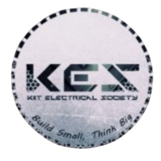

# KIIT Electrical Society (KES) — Official Web Platform

<p align="center">
  
</p>

<p align="center">
  <strong>School of Electrical Engineering, KIIT Deemed to be University, Bhubaneswar</strong><br />
  <em>"Build small, think big."</em>
</p>

<p align="center">
  
  
  
  
  
  
</p>

---

## 1. Overview & Society Identity

The **KIIT Electrical Society (KES)** is the premier student technical society under the School of Electrical Engineering at KIIT Deemed to be University, Bhubaneswar. Established to bridge theoretical circuit analysis with practical engineering, KES mentors undergraduate engineers across power systems, embedded electronics, robotics, renewable energy, and distributed IoT architecture.

### Institutional Visual Language
The platform features an intentional, technical aesthetic inspired by early electrical engineering labs and modern laboratory instrumentation:
- **Palette:** Deep laboratory green (`#0b1a13`, `#102f29`), warm brushed brass (`#c8963e`, `#e1c595`), and institutional technical parchment (`#f7f5ef`, `#ece7de`).
- **Typography:** Cormorant Garamond (display headlines) paired with Manrope (technical labels, numbers, and high-legibility body type).
- **Motion:** Orthogonal circuit signal flow canvas (`components/SignalFlowHero.js`) with responsive particle density reduction and strict `prefers-reduced-motion` compliance.

---

## 2. Core Capabilities

### 🌐 Public Experience
- **SignalFlow Canvas:** Interactive, hardware-accelerated circuit canvas rendering animated signal pulses along orthogonal PCB trace lines.
- **Milestone Timeline:** Interactive society timeline (`components/KesTimeline.js`) tracing annual technical symposiums, achievements, and project expos.
- **17-Project Engineering Showcase:** Detailed catalogue featuring all 17 authoritative society engineering projects with category filters, technical specifications, schematics, and team credits.
- **Event Chronicle:** Collapsible past-events ledger documenting flagship workshops (Kreative Kontrol, DarkRoute, Project Expo).

### ⚡ Join KES Recruitment System (`/join`)
- **Institutional Domain Allowlist:** Restricts applications strictly to 22 authorized `@kiit.ac.in` institutional domains.
- **Atomic OTP Verification:** Dispatches 6-character Crockford base32 one-time codes with HMAC validation and a 10-minute TTL.
- **Multi-Step Application Wizard:** Five-step structured application capturing academic records, technical and creative domain preferences, and portfolios.
- **Duplicate Prevention:** Unique compound indexes prevent duplicate submissions per cycle across roll numbers and emails.

### 🛡️ Administrative Portal (`/admin`)
- **Argon2id Authentication:** SIMD-accelerated password hashing with constant-time verification.
- **Role-Based Access Control (RBAC):** Distinct permission tiers for Full Administrators vs. Domain Reviewers (restricting candidate reviews strictly to assigned domains).
- **Optimistic Concurrency (CAS):** Version-controlled application updates prevent overwrite conflicts between simultaneous interviewers.
- **Safe CSV Export:** One-click applicant data exports with automatic formula injection protection (`=`, `+`, `-`, `@`).
- **Durable Email Dispatcher:** MongoDB-backed transactional notification queue for applicant acknowledgements, interview invitations, and domain acceptance links via **Brevo SMTP**.

---

## 3. Technology Stack

| Layer | Technologies |
| :--- | :--- |
| **Framework** | [Next.js](https://nextjs.org/) v16.4.0 (App Router, Turbopack, Server Actions) |
| **Frontend** | [React 19](https://react.dev/), Vanilla CSS Variables (`app/tokens.css`), Canvas API |
| **Runtime** | Serverless Node.js 20.x on Vercel |
| **Database** | [MongoDB Atlas](https://www.mongodb.com/atlas) (replica set with connection pooling & TTL indexes) |
| **Authentication** | Argon2id (`@node-rs/argon2`), signed HMAC session tokens, `__Host-` secure cookies |
| **Email Relay** | [Brevo](https://www.brevo.com/) SMTP (STARTTLS port 587) with durable MongoDB job queue |
| **Testing** | Node.js native test runner (`node:test`, TAP assertions), 82 test specs |

---

## 4. Quick Start for Developers

### Prerequisites
- Node.js `20.x` or `22.x` LTS
- npm `10+`
- Local MongoDB or a MongoDB Atlas cluster URI

### Installation & Run
```bash
# 1. Clone the official repository
git clone https://github.com/AyushKumar1624/KIIT-Eletrical-Society-Website.git
cd KIIT-Eletrical-Society-Website

# 2. Install dependencies
npm install

# 3. Configure environment variables
cp .env.example .env.local
# (Edit .env.local with your development MongoDB URI and SMTP credentials)

# 4. Verify your environment setup (does not leak secret values)
npm run env:check

# 5. Start development server
npm run dev
```

Open [http://localhost:3000](http://localhost:3000) in your browser.

> [!TIP]
> **Developing Offline?** If you don't have MongoDB installed locally, run `node scripts/dev-mongo.mjs` in a separate terminal to launch an in-memory MongoDB instance on port 27017.

---

## 5. Automated Operational Commands

All operational tasks are standardized under `scripts/operational/`:

```bash
# 1. Pre-flight Production Gate (runs secret scan, boundary audits, 17 projects, lint, 82 unit tests, mongo replica set tests, and build)
npm run production:check

# 2. Safe Database Initializer (idempotently ensures schemas, 10 indexes, default cycle, and CMS seeds without deleting data)
npm run production:init

# 3. Environment Validator (checks crypto key lengths, URIs, and Brevo settings without printing values)
npm run env:check

# 4. Administrator Provisioning Wizard (interactive CLI to provision Argon2id admin or domain reviewer accounts)
npm run admin:provision

# 5. Durable Email Queue Processor (drains pending applicant notifications with exponential backoff)
npm run jobs:process

# 6. CMS Content Synchronizer (upserts 17 projects and society records into MongoDB CMS collections)
npm run migrate-content

# 7. Recruitment Cycle Manager (inspects, opens, or closes recruitment application windows)
npm run recruitment:cycle status
npm run recruitment:cycle open --id 2026-27 --name "Recruitment 2026–27"
npm run recruitment:cycle close --id 2026-27
```

---

## 6. Codebase Architecture

```text
KIIT-Eletrical-Society-Website/
├── app/                  # Next.js App Router (Public routes, /join, /admin, /api)
│   ├── admin/            # Administrative review workspace & login
│   ├── api/              # API Route Handlers (/api/join/*, /api/admin/*, /api/content/*)
│   ├── join/             # Recruitment application flow
│   ├── portal/           # Reserved member portal (unreachable in production via *.prod.js)
│   ├── error.js          # Global 500 error boundary with institutional styling
│   ├── layout.js         # Root HTML layout, SEO metadata, theme fonts
│   └── page.js           # Public KES Homepage
├── components/           # Reusable UI Components
│   ├── admin/            # Admin review table, filter controls, candidate modal
│   ├── join/             # Recruitment wizard steps & OTP verification
│   ├── projects/         # 17-Project catalogue, modal dialogs, specifications
│   ├── SignalFlowHero.js # Interactive orthogonal circuit canvas
│   ├── KesTimeline.js    # Technical society milestones
│   └── SiteHeader.js     # Responsive header & mobile section index drawer
├── lib/                  # Business Logic & Infrastructure
│   ├── admin/server/     # Admin auth, sessions, RBAC, CSV export (server-only)
│   ├── backend/          # MongoDB pool, schemas, indexes (server-only)
│   ├── cms/              # Hybrid CMS service, MongoDB sync, static fallback (server-only)
│   ├── join/server/      # OTP generation, application storage, institutional mailer (server-only)
│   ├── notifications/    # Durable email jobs runner, retry scheduler (server-only)
│   ├── projects/         # Authoritative 17-project catalogue data & categories
│   └── content.js        # Public society records, leadership, events, media registry
├── scripts/              # Automation Tooling
│   ├── operational/      # 7 production scripts (check-env, production-check, etc.)
│   ├── dev-mongo.mjs     # In-memory MongoDB runner for offline local dev
│   └── test-mongo.mjs    # Real MongoDB replica set integration runner
├── tests/                # Automated Node.js TAP test suite (82 specifications)
├── docs/                 # Consolidated documentation suite
│   ├── architecture/     # README.md, CODEBASE_MAP.md (with team ownership boundaries)
│   ├── deployment/       # Vercel & MongoDB Atlas production guide
│   ├── development/      # Local developer setup and guidelines
│   ├── operations/       # Operational runbook, Brevo DNS auth, Atlas backups
│   └── security/         # Threat model, RBAC matrix, applicant data safeguards
└── public/               # Static assets, WebP event photography, and icons
```

---

## 7. Testing & Quality Assurance

Run the automated test suite locally at any time:

```bash
# Run 82 unit and integration tests
npm test

# Run real MongoDB replica set integration tests
npm run test:mongo

# Run ESLint (0 errors, 0 warnings enforced)
npm run lint

# Run Next.js production build
npm run build
```

---

## 8. Security & Invariant Rules

1. **Zero Secret Exposure:** Credentials, connection strings, and private keys (`ADMIN_SECRET`, `JOIN_SECRET`, `SMTP_PASS`, `MONGODB_URI`) are never committed, logged, or bundled into browser assets.
2. **Server-Only Isolation:** All database drivers, cryptographic signers, and administrative services enforce `import "server-only";` to guarantee strict client bundle decoupling.
3. **No Fake Success:** Recruitment submissions and email dispatches require atomic database commits and durable job creation before returning HTTP 200.
4. **Factual Integrity:** All 17 projects, executive office bearers, faculty mentors, and historical milestones reflect verified society records.

---

## 9. Comprehensive Documentation Index

- [Architecture Overview](docs/architecture/README.md)
- [Codebase Map & Team Ownership](docs/architecture/CODEBASE_MAP.md)
- [Local Development Guide](docs/development/README.md)
- [Production Deployment Guide (Vercel & Atlas)](docs/deployment/README.md)
- [Operational Runbook & Brevo Email DNS Authentication](docs/operations/README.md)
- [Security Architecture & Threat Model](docs/security/README.md)

---

## 10. Institutional Credits

- **Faculty In Charge:** Dr. Shubhasri Kundu, School of Electrical Engineering, KIIT
- **Founding Faculty Mentor:** Dr. Manoj Kumar Maharana, School of Electrical Engineering, KIIT
- **Organization:** KIIT Electrical Society (KES), School of Electrical Engineering, KIIT Deemed to be University, Bhubaneswar, Odisha, India.