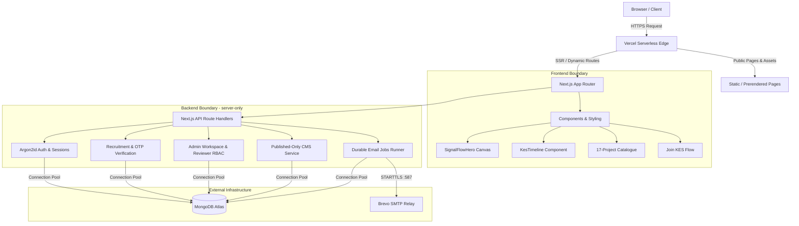

# KIIT Electrical Society (KES) — Architecture Overview

The official web platform of the KIIT Electrical Society is built on Next.js App Router (v16.4.0) with a hybrid serverless architecture backed by MongoDB Atlas, Argon2id cryptographic identity, Brevo SMTP email delivery, and a published-only CMS.

---

## 1. High-Level System Architecture

---

## 2. Core Architectural Invariants

1. **Frontend / Backend Decoupling:**
   - Client components (`"use client"`) NEVER import database drivers, SMTP transports, admin services, or server-only modules.
   - All server modules are protected with `import "server-only";` to guarantee zero server bundle leakage into browser bundles.
2. **Stateless Serverless Execution:**
   - Handlers do not depend on process memory, filesystem writes, or long-running daemons.
   - MongoDB connections are cached on `globalThis.__kesMongo` with connection pooling limits (`maxPoolSize: 10`, `minPoolSize: 0`, `serverSelectionTimeoutMS: 5000`).
3. **Durable Notification Jobs:**
   - Email notifications (acknowledgement, admin alerts, interview invitations, selections) are written durably to MongoDB as `notification_jobs` before attempting dispatch.
   - Delivery failures trigger exponential backoff retries without blocking HTTP responses.
4. **Institutional Security:**
   - Exact institutional email allowlist for applicants (22 KIIT domains).
   - Atomic OTP consumption preventing race conditions.
   - Argon2id password hashing (memory cost 65536 KB, time cost 3, parallelism 1) for administrators.
   - `__Host-` prefixed secure session cookies in production.
   - Strict CSRF origin verification, request size capping (20 KB), and CSV formula injection protection.
5. **CMS Isolation:**
   - MongoDB is the dynamic CMS backend; public APIs (`/api/content/[type]`) strictly enforce `{ published: true }`.
   - Unpublished drafts, internal notes, and applicant records never leak to public endpoints.
   - Graceful static fallback ensures zero downtime if the database is unpopulated.
