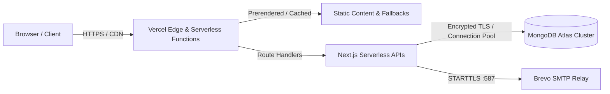

# Production Deployment Guide — Vercel & MongoDB Atlas

This document outlines the deployment architecture, configuration requirements, and operational steps for deploying the KIIT Electrical Society (KES) website to Vercel with MongoDB Atlas.

---

## 1. Production Architecture Overview

The KES web platform is architected for zero-downtime, serverless execution on **Vercel** paired with a managed **MongoDB Atlas** replica set.



---

## 2. Platform Requirements & Settings

### Node.js Runtime
- **Recommended Version:** Node.js `20.x` or `22.x` LTS.
- Defined in `package.json` engines or Vercel Project Settings -> General -> Node.js Version.

### Build and Output Settings
- **Framework Preset:** Next.js
- **Build Command:** `npm run build` (or `next build`)
- **Output Directory:** `.next` (default)
- **Install Command:** `npm install`

---

## 3. Environment Variables Configuration

Configure these environment variables in **Vercel Project Settings -> Environment Variables**. Apply them to **Production** (and **Preview** if preview testing is required).

> [!CAUTION]
> **Zero Secret Leakage:** Never commit secrets to Git. Never paste credentials into public channels or ticket descriptions. Values shown below are safe syntactic examples only.

| Variable | Required in Prod | Purpose | Example Format / Guidance |
| :--- | :---: | :--- | :--- |
| `NODE_ENV` | Yes | Controls Next.js runtime optimizations and cookie security flags | `production` |
| `NEXT_PUBLIC_SITE_URL` | Yes | Canonical origin for absolute links, SEO tags, and CORS | `https://electrical.kiit.ac.in` |
| `MONGODB_URI` | Yes | Connection string to MongoDB Atlas replica set | `mongodb+srv://<username>:<password>@<cluster-host>/kes_production?retryWrites=true&w=majority` |
| `ADMIN_SECRET` | Yes | 64-character hex secret for signing admin session tokens | Generate with: `node -e "console.log(crypto.randomBytes(32).toString('hex'))"` |
| `JOIN_SECRET` | Yes | 64-character hex secret for signing applicant verification tokens | Generate with: `node -e "console.log(crypto.randomBytes(32).toString('hex'))"` |
| `CSRF_SECRET` | Yes | 64-character hex secret for CSRF token encryption | Generate with: `node -e "console.log(crypto.randomBytes(32).toString('hex'))"` |
| `SMTP_HOST` | Yes | Hostname for SMTP relay (Brevo) | `smtp-relay.brevo.com` |
| `SMTP_PORT` | Yes | Port for secure SMTP submission | `587` |
| `SMTP_USER` | Yes | Authorized Brevo SMTP account email | `example@domain.com` |
| `SMTP_PASS` | Yes | Master Brevo SMTP relay key (never shared) | `xkeysib-...` |
| `EMAIL_FROM` | Yes | Sender header shown on all outgoing notifications | `KIIT Electrical Society <24161010@kiit.ac.in>` |
| `EMAIL_REPLY_TO` | No | Default reply-to header for applicant queries | `24161010@kiit.ac.in` |
| `CRON_SECRET` | No | Bearer token for triggering scheduled job processing via HTTP | 64-character hex string |
| `NEXT_PUBLIC_PORTAL_DEMO` | **NO** | Must remain unset or `false` in production to prevent portal demo leakage | Unset in production |

---

## 4. Serverless Region & Database Latency

To achieve sub-100ms response times:
1. **MongoDB Atlas Region:** Hosted in AWS `ap-south-1` (Mumbai) or the nearest Indian cloud zone.
2. **Vercel Function Region:** Set Vercel Function region to `bom1` (Mumbai, India) under **Project Settings -> Functions -> Function Region**. This places serverless instances physically close to the database cluster, minimizing connection handshakes.
3. **Connection Pooling:** The KES MongoDB driver (`lib/backend/mongo.js`) maintains a global cached client with:
   - `maxPoolSize: 10`
   - `minPoolSize: 0`
   - `serverSelectionTimeoutMS: 5000`
   - `connectTimeoutMS: 5000`

---

## 5. Pre-Deployment Verification

Before triggering any production build or merge, execute the full local validation pipeline:

```bash
# 1. Verify all required environment variables are correctly shaped
npm run env:check

# 2. Run the complete automated pre-flight production check
npm run production:check
```

The automated check guarantees:
- Zero raw secrets or keys are tracked in the codebase.
- Frontend and backend boundaries are strictly isolated (`import "server-only"`).
- All 17 projects in the society catalogue are present with valid metadata.
- ESLint checks pass with 0 errors.
- Unit and MongoDB replica set test suites pass 100%.
- Next.js production build succeeds with clean tree shaking.

---

## 6. Post-Deployment Smoke Checklist

Once the production deployment finishes, verify these endpoints in a private browser window:
1. **Public Homepage (`/`):** Confirm 200 OK, hero canvas draws smoothly, 17 projects render in the catalogue, milestone timeline expands.
2. **Join KES (`/join`):**
   - Confirm active recruitment cycle status is displayed.
   - Enter a test institutional email (`@kiit.ac.in`) to verify OTP issuance.
3. **Admin Portal (`/admin/login`):**
   - Verify HTTPS lock and `__Host-` cookie attributes in browser dev tools.
   - Test login with authorized administrator credentials.
   - Verify application list loads and RBAC controls restrict unpermitted views.
4. **Member Portal Gate (`/portal`):** Confirm `/portal` returns the institutional "Not Available" notice (`components/PortalUnavailable.js`) with HTTP `noindex`.
