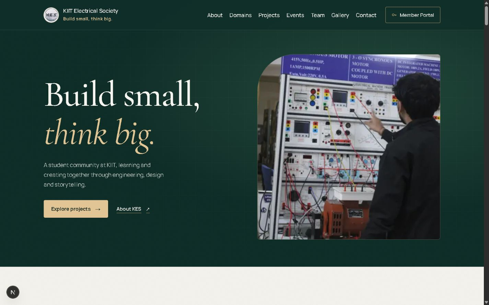
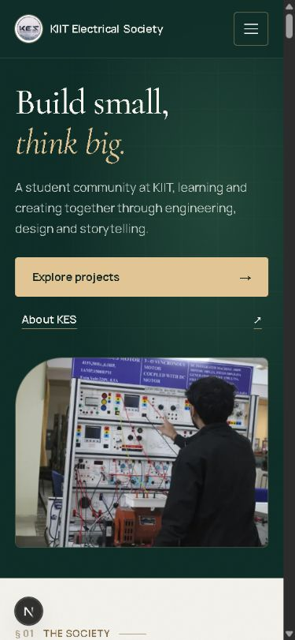

# Public navigation and hero — 15 October 2026

The opening spread now contains the exact motto, one concise introduction, a gold primary action (Explore projects), a quiet secondary action (About KES), and the existing DarkRoute machines-lab photograph with its descriptive alt text. Removed the overlaid caption, second photograph, decorative drawing, three hero labels, repeated exploration link and decorative domain strip. Detailed domain content and all public sections remain available.

Navigation uses readable 16px desktop links and 17px menu links. Member Portal has a full, non-shrinking label and a 48px desktop/52px menu hit area. The menu appears at 1280px and below, before the links become crowded. The shared header-height variable also positions the menu and supplies native anchor clearance: 88px desktop/76px phone header plus 16px breathing room. Section navigation moves keyboard focus to the destination heading after closing the drawer.

Checks: widths 320, 390, 768, 1000, 1280, 1281 and 1440; no document overflow or portal-label clipping. Hero DOM has one photograph and two links. All seven navigation anchors and both hero actions land below the header. Verified mobile menu dismissal, scroll-lock release and destination-heading focus. No browser console errors. Lint, all eight existing tests and the Next.js production build passed.

Styles are scoped in `app/navigation-hero.css`, after the existing shared design system. The current stack, forest green/ivory/gold palette, serif display, public content, portal and gallery/event behaviour are preserved. No new people, projects, dates, statistics or imagery were introduced.
