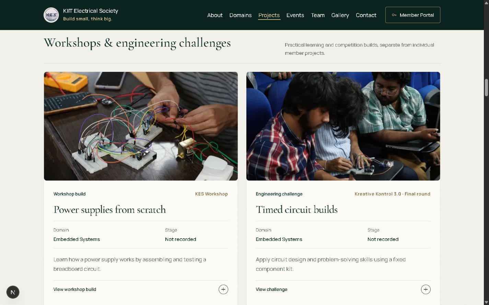
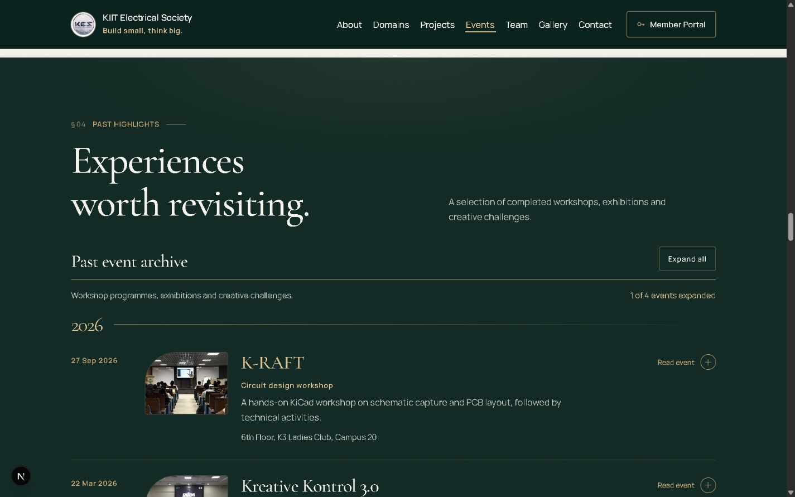
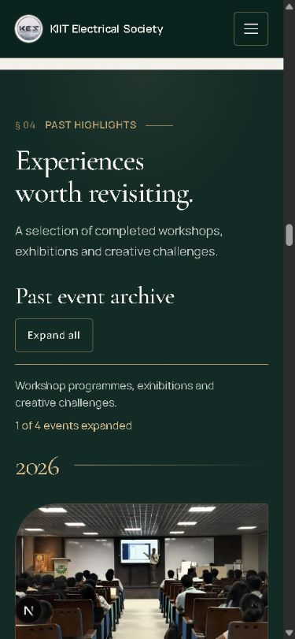

# Projects and Events refinement — 15 October 2026

## Content and presentation

Projects now separates four kinds of record: member projects, workshops/engineering challenges, event highlights, and creative work. The member section uses the 12 existing `ARCHIVE_PROJECTS` entries in a collapsible archive, preserving their titles, descriptions and tool lists. Their original categories remain in the detail views; the public domain labels use the current KES domain names.

Every card has a reserved image area, type/origin, title, domain, stage field, concise description and a context-specific native disclosure action. Existing photographs stay attached to their documented workshops/events/creative assets. Member project photographs and development stages were not supplied: these show explicit placeholders and “Not recorded,” without borrowing another project's image or assuming progress. Posters use contain rather than cover so the complete graphic remains visible.

The five existing documented records retain their `work-p-01`, `work-p-03`, `work-p-04`, `work-c-01` and `work-c-02` anchor IDs, preserving the domain links. Shared presentation data lives in `lib/showcase.mjs`; the scoped visual layer is `app/projects-events.css`.

Events retains the four existing published past highlights and their source content. The archive now has clearer date/title/description hierarchy, readable year labels, visible Read event/Close details states, and a polite expansion-count announcement. Expand/collapse-all and event deep links retain native disclosure behaviour. No dates, participants, sponsors, registration destinations or upcoming announcements were added. KHAOS OF CIRCUIT 2.0 remains an unscheduled portal concept; no public schedule is implied.

## Verification

- Checked expanded project cards and event details at 320, 390, 768 and 1440px. No document overflow, clipped metadata/headings, or broken loaded card images.
- Checked the member-archive and individual-project disclosures using Enter; checked single-event expansion and expand/collapse-all counts (1 → 4 → 0).
- Confirmed `/#ev-project-expo-2025` opens its detail view below the fixed header and that existing domain-to-work anchors resolve.
- Browser error log clean. `npm run lint`, all eight existing tests and `npm run build` passed; 34 static pages generated.

The legacy member archive is existing repository content, not newly researched project claims. Its original source (`kes-v2.vercel.app`) could not be retrieved during this pass. Before enriching those records, KES should supply approved individual photographs, team credits, current development stages and any additional project destinations. No missing information was fabricated.

