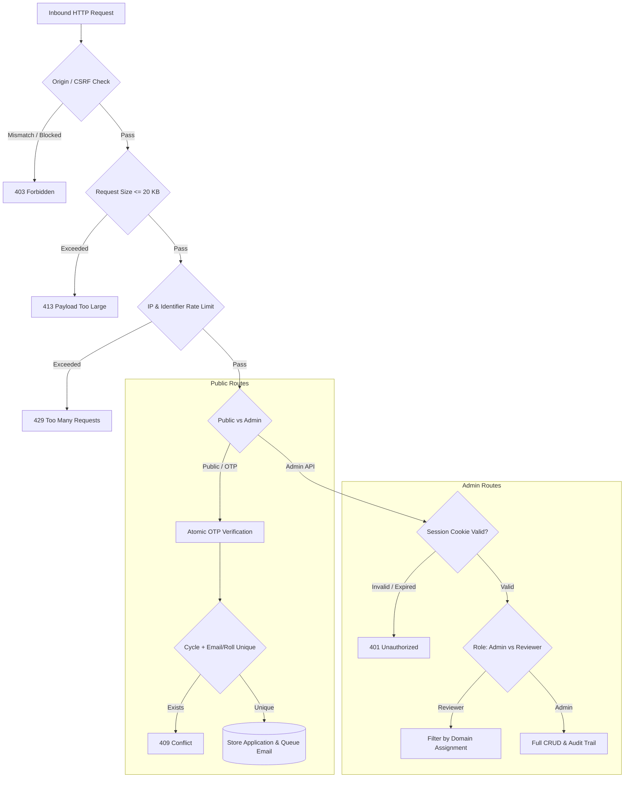

# KES Security Architecture & Threat Model

This document outlines the security architecture, cryptographic primitives, authentication models, and data protection controls implemented across the KIIT Electrical Society (KES) website and API services.

---

## 1. Security Architecture Summary

---

## 2. Authentication & Cryptography

### 2.1 Password Hashing (Argon2id)
- **Library:** `@node-rs/argon2` (native SIMD-accelerated implementation).
- **Parameters:**
  - Memory cost (`memoryCost`): `65536` KB (64 MB)
  - Time cost (`timeCost`): `3` iterations
  - Parallelism: `1` thread
  - Output length: `32` bytes
- **Mitigation against timing attacks:** Constant-time password verification routines (`crypto.timingSafeEqual`) prevent side-channel timing leaks.

### 2.2 Administrator Session Management
- **Token Format:** Signed symmetric session tokens using HMAC-SHA256 keyed with `ADMIN_SECRET`.
- **Payload:** `adminId`, `sessionVersion`, `role`, `domain`, `issuedAt`, `expiresAt`.
- **Timeouts:**
  - **Idle Timeout:** 2 hours of inactivity.
  - **Absolute Expiration:** 24 hours from original issuance.
- **Session Revocation (Auth Versioning):** Incrementing `authVersion` on an administrator record immediately invalidates all active session tokens and cookies.
- **Cookie Security:**
  - `HttpOnly`: Accessible only via HTTP headers, inaccessible to client-side JavaScript.
  - `SameSite=Lax` (or `Strict` for mutations).
  - `Secure`: Transmitted strictly over TLS/HTTPS.
  - Cookie prefix: `__Host-kes_admin_session` in production (`Secure; Path=/; SameSite=Lax`).

### 2.3 Applicant Verification (Join KES OTP)
- **Code Format:** 6-character cryptographically random base32 Crockford code.
- **Allowed Domains:** Strictly enforced institutional allowlist of 22 KIIT domains (`@kiit.ac.in`, `@it.kiit.ac.in`, `@cs.kiit.ac.in`, etc.).
- **TTL & Expiry:** 10 minutes (backed by MongoDB TTL index).
- **Attempt Limits:** Maximum 3 verification attempts per OTP code before revocation.
- **Atomic State Transitions:** Verification uses atomic `findOneAndUpdate` with condition `{ used: false }` to prevent concurrent race condition replay attacks.

---

## 3. Authorization & Role-Based Access Control (RBAC)

Two distinct roles govern the administrative workspace:

| Capability | Full Administrator (`admin`) | Domain Reviewer (`reviewer`) |
| :--- | :---: | :---: |
| View All Applications | Yes | No (Only assigned domain) |
| Read/Edit Application Details | Yes | Yes (Restricted to assigned domain) |
| Add Internal Notes | Yes | Yes (Restricted to assigned domain) |
| Move Status (Screening/Interview) | Yes | Yes (Restricted to assigned domain) |
| Final Acceptance / Rejection | Yes | No |
| Export Applications to CSV | Yes | No |
| Manage Recruitment Cycles | Yes | No |
| Provision/Revoke Admins | Yes | No |
| Edit CMS Published Content | Yes | No |

### Audit Logging & Concurrency
- **Audit Trails:** Every status transition, note addition, and reviewer action appends an immutable entry to `auditHistory` capturing: `actorId`, `actorEmail`, `action`, `timestamp`, and `details`.
- **Optimistic Concurrency Control:** Application mutations require matching `_version` (CAS) preventing overwriting simultaneous reviewer modifications.

---

## 4. Input Sanitization & Anti-Abuse Defenses

### 4.1 Cross-Site Request Forgery (CSRF)
- State-modifying requests (`POST`, `PUT`, `DELETE`) require:
  1. Valid `Origin` or `Referer` matching `NEXT_PUBLIC_SITE_URL`.
  2. CSRF token header (`x-kes-csrf-token`) validated against cryptographic HMAC cookie.

### 4.2 CSV Formula Injection Defense
- When exporting applicant records to CSV (`/api/admin/applications/export`), all text fields starting with dangerous formula triggers (`=`, `+`, `-`, `@`, `\t`, `\r`) are sanitized by prepending a single quote (`'`). This prevents malicious formula execution in Microsoft Excel or LibreOffice Calc.

### 4.3 Request Size Capping
- API route handlers enforce a strict request body size limit of **20 KB**. Any payload exceeding this threshold is rejected with HTTP `413 Payload Too Large`, guarding against denial-of-service memory exhaustion.

### 4.4 Rate Limiting
- Public endpoints (`/api/join/request-otp`, `/api/join/verify-otp`, `/api/admin/login`) enforce sliding window rate limiting per client IP address and per institutional identifier.
- Exceeded thresholds return `429 Too Many Requests` with `Retry-After` headers.

---

## 5. Information Leakage & Logging Guardrails

- **Zero Secret Exposure:** Server logs never record passwords, raw tokens, connection strings, or SMTP credentials.
- **PII Protection:** Applicant phone numbers and roll numbers are never logged in plaintext.
- **Production Cache Headers:** All admin and applicant verification routes emit `Cache-Control: private, no-cache, no-store, must-revalidate` and `Pragma: no-cache` to ensure sensitive payloads are never cached by intermediate proxies or browser history.
- **Robots & Indexing:** Admin routes and portal gates emit `X-Robots-Tag: noindex, nofollow`.
