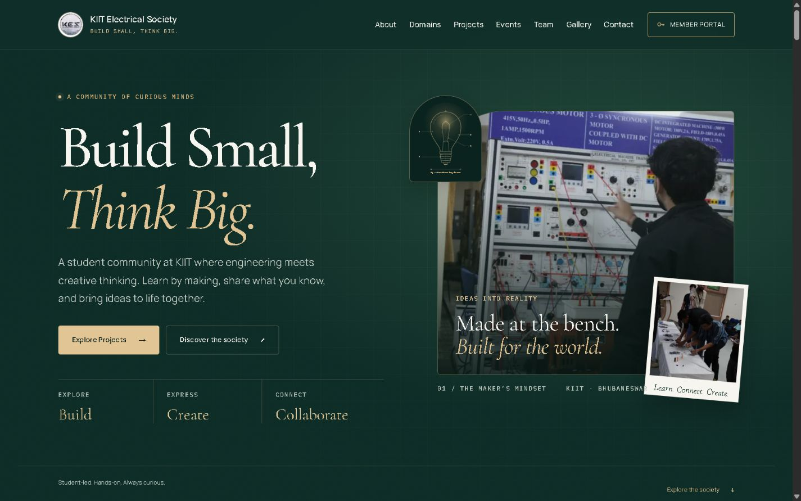

# KES implementation and verification — 14 October 2026

## What is built



The public homepage contains About KES, all nine technical and creative domains, five documented work cards with native detail disclosures, selected past events, office bearers, Faculty In Charge, Founding Faculty, a 16-photo gallery with a keyboard-accessible viewer, and the approved contact channels. There is no public live/upcoming event announcement or registration link.

The frontend member portal contains exactly nine navigation sections: Overview, Domains, Announcements, Events, Calendar, Membership ID card, Notifications, My profile and Settings. Overview has domains and My Projects. Members can apply to demo briefs, record new or previous builds, add collaborators and optional LinkedIn links, and edit their own project records. No task/pending/completed dashboard remains. KHAOS OF CIRCUIT 2.0 is an unscheduled portal concept with separate Day 1 engineering challenge and Day 2 project expo summaries.

## Checks and fixes

- Production homepage and all nine workspace routes checked at **320 × 740**, **768 × 1024**, and **1440 × 900**. Additional visual checks at 390 × 844. Each loaded page has one H1; no document horizontal overflow, missing image alt attributes, or broken loaded images were found. The phone calendar intentionally scrolls inside a focusable, labelled region.
- Fixed narrow-phone membership card clipping, tiny card labels, crowded breadcrumbs, out-of-bounds notification menus and inconsistent touch target sizes. Portal dropdowns dismiss outside and restore trigger focus on Escape; the drawer releases its scroll lock when resized to desktop.
- Checked keyboard menu containment, Escape/trigger focus, native project/event disclosures, native modal focus, gallery arrow-key navigation and focus restoration. Gallery controls now fit inside short/narrow viewports. Modal backgrounds do not scroll; validation errors are displayed and focused inside the modal rather than hidden behind its top layer.
- Also checked the gallery at **660 × 360**: close, previous and next controls stay within the landscape phone viewport. Closing a portal dialog explicitly restores its opener's focus.
- Checked light/dark portal text contrast using computed colors against backgrounds and visually inspected photographic captions. Decorative event bolts and archive-year outlines are excluded from meaningful-text contrast checks. Added opaque caption backdrops and darker focus outlines on light public panels. Forms expose labels; error messages use an alert; gallery captions announce photo changes.
- Verified the OS reduced-motion setting with animations disabled. A CSS media-query fallback works even if the head script is unavailable. Hero and section content is visible by default; observer failure cannot conceal sections. Gallery visibility/close behaviour no longer relies on animation timers.
- Responsive Next Image sizes, modern WebP sources, reserved image dimensions, high-priority lead image, lazy below-the-fold photos, and self-hosted `next/font` fonts are in use. Removed an unsupported gallery image-quality override. Paper texture is a small, static inline SVG; it does not animate or fetch a large bitmap.
- Page description, social cards, icons, robots and sitemap use approved society information. Portal metadata identifies the frontend demo and excludes it from indexing; it no longer inherits the homepage canonical.
- `npm run lint`, `npm test` (**8 passing tests**) and `npm run build` passed. Production generated 34 static pages. `node scripts/audit-site.mjs http://localhost:3001` checked **51 registered image assets**, **30 routes**, and linked CSS/font files. The source-image registry totals 4.74 MB; visitors receive responsive derivatives and lazy loading rather than every original at once.
- Fresh production browser logs contained no warnings or errors. Internal navigation/hash destinations were checked; legacy task/directory routes redirect to Overview. Mailto links were inspected without sending email.

Both official faculty profile destinations resolve: [Shubhasri Kundu](https://electrical.kiit.ac.in/profiles/shubhasri-kundu/) and [Manoj Kumar Maharana](https://electrical.kiit.ac.in/profiles/manoj-kumar-maharana/). Academic ranks in the previous copy were not consistently supported by those pages, so the site displays school affiliation and the confirmed society roles. Instagram and LinkedIn prevented automated retrieval; their supplied URLs are retained, but signed-in availability/ownership was not independently verified in this pass.

This is a local Chromium/browser inspection, not a formal accessibility certification or a measured Lighthouse/Core Web Vitals score. Native touch swipe handling was reviewed in code; arrow-key and button navigation were exercised in the gallery. Actual-device touch/screen-reader and other-browser testing remain useful before a production release.

## Run locally

```bash
npm install
npm run dev -- --port 3110
```

Open `http://localhost:3110/`. To inspect an optimized build:

```bash
npm run lint
npm test
npm run build
npm run start -- --port 3001
```

Open `http://localhost:3001/` and `/join`. Every `/portal` address serves a noindex "not available" page pointing to Join KES, in development and production alike, unless a developer sets `NEXT_PUBLIC_PORTAL_DEMO=true`. To review every Join KES screen, run `npm run dev` and open `/join?preview=1` (see `docs/join-kes-integration.md`). In another terminal: `node scripts/audit-site.mjs http://localhost:3001`.

## Exact real content and destinations still needed

1. **Approved live website URL** for `NEXT_PUBLIC_SITE_URL`, canonical/social URLs and the production sitemap. The sitemap intentionally has no public URL until this is supplied. Nothing has been deployed.
2. **Individual project records** if replacing descriptive workshop/event work cards: official project titles, purposes, domains, original photographs, owners/collaborators, approved outcomes and actual repository/demo/LinkedIn destinations. The current cards describe documented work without naming invented projects or winners.
3. **Real portal member and project data**: approved member roster, role/domain assignments, membership identifiers, project opportunity briefs and member-submitted profiles/projects/LinkedIn URLs. Current records and dated portal activities are clearly fictional.
4. **Production portal services and destinations**: approved KIIT sign-in/SSO configuration, authenticated authorization, persistent member/project/announcement/event storage, uploaded-photo storage, and an official membership-verification endpoint before issuing real ID cards or QR codes. Phase 1 is browser-session storage only; it does not provide shared society-wide data or real identity verification.
5. **Official announcements/calendar data and delivery services**, when ready to activate them: approved messages and confirmed activity dates, plus email/push endpoints only if those channels are wanted. No real messages or applications are sent by the demo.
6. **Future event details only when an event is actually confirmed**: KHAOS OF CIRCUIT 2.0 date/time, venue, final Day 1/Day 2 arrangements, rules, eligibility and official registration destination. None is published now, and no imminent event is implied. For expanding the past archive, DarkRoute needs its date/format; the power-supply workshop needs date/venue/speaker; KSHITIJ needs the specific competition and any approved results. Those unknown fields stay unpublished.
7. **Optional faculty academic ranks** if KES wants them displayed: confirmation of current rank/designation. The existing Faculty In Charge and Founding Faculty attribution is retained.

No new sponsors, achievements, event dates, individual team names or statistics were invented. The existing society email, faculty profile links and supplied Instagram/LinkedIn destinations are already wired; no replacement public destination is required unless KES changes them.
